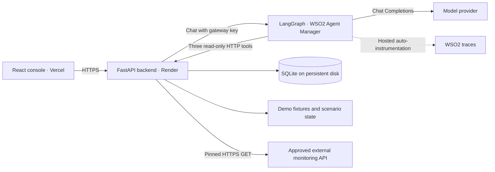

# OpsGuard AI

[](https://github.com/SKirushanth/opsguard-ai/actions/workflows/release.yml)

Pull requests run Python and frontend checks. Main releases use Azure OIDC and the existing Container Apps. See the [production pipeline runbook](docs/pipeline.md) for the data safeguard, WSO2 checkpoint and rollback.


OpsGuard brings a service's health, recent logs and performance metrics into one incident investigation. Developers can inspect the evidence, ask a LangGraph agent for a likely cause, and approve a report for the incident history. The built-in application simulates Auth, Orders and Notifications. Registered applications supply their own monitoring data.

## Architecture



The frontend uses React, TypeScript, Vite and Tailwind CSS. Both Python applications use FastAPI, Pydantic and HTTPX. The backend owns SQLite and all external monitoring credentials. The agent owns its model credential and receives monitoring data through HTTP.

```text
agent/                  Chat server, model settings, LangGraph, prompt and tools
backend/app/data/       Original Day 1 monitoring fixtures
backend/app/routes/     Monitoring endpoints and agent proxy
backend/app/            Sessions, scenarios, incident store, registry and HTTPS reader
frontend/src/           Dashboard, service details, investigator, incidents and applications
tests/                  Python regression, boundary and two-server integration tests
docs/api-contract.md    Wire formats, external endpoint examples and errors
render.yaml             Backend Blueprint with persistent disk
frontend/vercel.json    Frontend production build settings
.env.example            Server configuration template
```

## Run with Docker

From this repository, run `docker compose up --build` and open **http://localhost:8080**. This starts the React/Nginx frontend and the monitoring backend with a persistent SQLite volume. The agent is optional. For operator actions, set `OPERATOR_PASSWORD` in the root `.env` and recreate the backend with `docker compose up -d`. Stop with `docker compose down` to retain the volume.

The Azure configuration deploys these two images from ACR, keeps the backend private, and reserves agent hosting for WSO2. [Local container settings and Azure deployment guide](docs/azure-deployment.md)

## Local setup

Use Python 3.11 or later and Node 22.12+ or a compatible newer release. From this repository in PowerShell, set up the environment once. Keep an existing local configuration when present.

```powershell
py -3.13 -m venv .venv
.\.venv\Scripts\python.exe -m pip install -r requirements.txt
if (!(Test-Path .env)) { Copy-Item .env.example .env }
npm.cmd ci --prefix frontend
```

Set `OPERATOR_PASSWORD` in the root `.env` to a strong random password. Set `LLM_API_KEY`, `LLM_MODEL` and `LLM_BASE_URL` for a provider with OpenAI-compatible Chat Completions and function calling. On Windows, run `.\start.ps1` from the repository root to start all three servers in one terminal. Press Ctrl+C to stop them together.

To start each process in its own terminal, run these commands from the repository root.

```powershell
.\.venv\Scripts\python.exe -m backend.app.main
.\.venv\Scripts\python.exe -m agent.main
npm.cmd run dev --prefix frontend -- --host localhost
```

Open the [dashboard](http://localhost:5173) and choose **Operator sign-in** for simulation, registration and incident controls. Backend Swagger runs on [port 8001](http://localhost:8001/docs) and agent Swagger on [port 8000](http://localhost:8000/docs). On Linux or macOS, create the virtual environment with `python3 -m venv .venv`, use `.venv/bin/python` and use `npm` in place of `npm.cmd`.

## Environment

Existing process variables take precedence over the root `.env`. Vite reads its own `frontend/.env` or build environment.

| Setting | Where | Default or value |
| --- | --- | --- |
| `LLM_API_KEY`, `LLM_MODEL`, `LLM_BASE_URL` | Agent | Empty key, `gpt-4o-mini`, `https://api.openai.com/v1` |
| `LLM_TIMEOUT_SECONDS` | Agent | 20 seconds per model call |
| `MONITORING_API_BASE_URL`, `MONITORING_TIMEOUT_SECONDS` | Agent | Local backend on 8001, 5 seconds per read. Set to the real Render HTTPS origin in WSO2 |
| `MONITORING_API_KEY` | Backend and agent | Shared read-only secret for protected monitoring endpoints |
| `AGENT_CHAT_URL`, `AGENT_API_KEY` | Backend | Local agent on port 8000 at `/chat`, empty key. In cloud use the full WSO2 invocation URL and endpoint key |
| `AGENT_CHAT_TIMEOUT_SECONDS` | Backend | 65 seconds. Agent deadline is 60 seconds |
| `BACKEND_HOST`, `BACKEND_PORT`, `PORT` | Backend | The example binds to loopback locally. Without a host override the server listens on all interfaces. `PORT` overrides port 8001 |
| `AGENT_PORT` | Agent | 8000 |
| `CORS_ORIGINS` | Backend | Comma-separated exact origins, default `http://localhost:5173` |
| `OPERATOR_PASSWORD` | Backend | Empty disables sign-in. Render generates a secret |
| `PROTECT_READS` | Backend | `false` enables public local reads and chat. Use `true` in hosted environments |
| `DATABASE_PATH` | Backend | Repository-relative default `.local/opsguard.sqlite3`. An explicit relative path resolves against process CWD |
| `APPROVED_HTTPS_ORIGINS` | Backend | Comma-separated origins, e.g. `https://monitor.example.com`. Empty disables integrations |
| `EXTERNAL_BEARER_TOKENS` | Backend secret | JSON map of exact external endpoint URLs to read-only bearer tokens, default `{}` |
| `VITE_API_BASE_URL` | Frontend | Monitoring backend origin, default `http://localhost:8001`. This build-time value is public |

## Investigation and reporting

The initial fixtures show Orders down with HTTP 503, a 42% error rate, and 100 of 100 database connections in use. Reset the demo to start an all-healthy walkthrough. Auth can simulate token validation failure, Orders can exhaust its connection pool, and Notifications can simulate SMTP timeouts. Reset and activation change health, logs and metrics together. “Last checked” is the time the browser successfully fetched health. Log timestamps describe the observations themselves.

The agent can call `get_service_health`, `get_service_logs` and `get_service_metrics`. The console passes the selected service ID with each investigation. The graph restricts a scoped investigation to that ID, requires a tool result, and caps the run at nine tool calls and twelve graph steps. Missing capabilities and failed reads are reported as unavailable. A successful check describes the observed endpoint.

Select **Prepare incident draft** after an investigation. The agent rechecks the selected service using the preceding answer as background. The backend validates the structured report. Review the evidence, likely cause, severity and recommendations before clicking **Confirm incident creation**. Only the authenticated confirmation endpoint writes the report. An approval UUID makes retries idempotent. The UI displays the persisted ID and lets an operator resolve or reopen the incident.

## Connect another service & Universal Monitoring Adapter

OpsGuard AI separates responsibilities strictly across three layers:

- **Python handles deterministic health classification** (`backend/app/normalizer.py`). Routine health checks, connection tests, and mapping validation never invoke the LLM.
- **Developers configure unfamiliar response formats** using nested JSON field paths and explicit value lists.
- **AI investigates meaningful monitoring evidence** (logs and unit-safe metrics) without ever guessing or overriding deterministic health status.
- **Unknown information is never guessed.** Unrecognized or ambiguous health payloads remain `unknown` (`requires_mapping: true`), and missing logs or metrics are marked unavailable rather than zero or "no errors".
- **WSO2 Agent Manager continues hosting, managing, and observing the AI agent** over the existing `/chat` contract and OpenAI-compatible tool-calling trace spans.

### Setup & registration flow

1. The operator adds the canonical public HTTPS origin to `APPROVED_HTTPS_ORIGINS` and configures any endpoint-specific bearer tokens in `EXTERNAL_BEARER_TOKENS` on the backend.
2. Sign in, open **Applications**, and enter the application name, service ID, Backend URL, health endpoint, and optional logs/metrics endpoints.
3. Choose **Automatic response detection** (default) or **Custom response mapping**, and click **Test Connection** to inspect the connection result, actual HTTP status, sanitized response, normalized status, and explanation without saving or calling the LLM.
4. If the response format is unrecognized (`status: "unknown"`, `requires_mapping: true`), configure custom mapping fields, click **Preview & validate mapping**, and save with **Register application**. Select **Open dashboard** to inspect or investigate the service.

### Normalization priority

Health responses are normalized deterministically into `healthy`, `degraded`, `down`, or `unknown` in strict order:

1. **HTTP and network errors:** Connectivity/DNS/timeout failures (`connectivity_failure`), HTTP 401/403 (`authentication_failure`), blocked 3xx redirects, malformed JSON, and non-503 4xx/5xx endpoint errors (`endpoint_error`) classify as `unknown` without assuming the whole application is down. HTTP 503 is accepted as `down`/`degraded` only when the JSON body consistently confirms it.
2. **Explicit custom field mappings:** When configured, OpsGuard traverses the dot-separated `status_field` and matches string or boolean values without falling back to automatic detection if the field is missing or unmapped.
3. **Recognized response patterns:** Automatically detects native OpsGuard health JSON, standard status tokens (`UP`, `OK`, `HEALTHY`, `DEGRADED`, `WARN`, `DOWN`, `OUT_OF_SERVICE`, `ERROR`, `FAIL`), boolean `{"healthy": true|false}`, and consistent nested indicators (`components`, `health`, `data`, `result`, `checks`). Contradictory indicators classify as `unknown` with `requires_mapping: true`.
4. **Unrecognized fallback:** Returns `status: "unknown"`, `reason: "Unrecognized health response format"`, and `requires_mapping: true`.

### Custom response mapping example

```json
{
  "status_field": "application.currentState",
  "healthy_values": ["ACTIVE"],
  "down_values": ["INACTIVE"],
  "degraded_values": ["LIMITED"]
}
```

Mappings reject invalid paths, blank entries, and conflicting values across classifications, persist in SQLite via the application registry, and never execute dynamic code.

### Logs, metrics, and AI investigation boundaries

- **Logs:** Supports compatible JSON log arrays/objects and bounded plain-text logs (up to 64 KiB / 100 lines). Unfamiliar JSON log payloads preserve bounded, secret-redacted `raw_evidence`. Missing logs return HTTP 501 / `"Unavailable"` and are never treated as evidence of zero errors.
- **Metrics:** Normalizes only recognized fields with explicit known units (`error_rate_percent`, `avg_latency_ms`, `requests_last_5m`, `active_db_connections`, `db_connection_limit`). Missing or unitless fields stay unavailable (`null`) and are never invented as `0`. Complex universal metrics mapping is intentionally out of scope for this MVP.
- **AI investigations** use a short list of evidence references. The model can select observations and supported causes. The gateway reads the referenced resources, validates each citation, then renders monitored health, observations and possible causes separately. If the model supplies prose or an unsupported cause, the answer contains only verified observations. An unknown health result with no diagnostic evidence ends before the diagnosis call. A cited hypothesis still needs operator review.

### Security restrictions

The adapter checks DNS on registration and every read, rejects private, loopback, link-local, multicast, and reserved answers, and connects to a validated public IPv4 address using `Host` and TLS SNI pinning. It uses read-only HTTP `GET`, disables proxies and redirects, requires identity encoding, enforces a 5-second timeout and 64 KiB size cap, and scrubs bearer tokens and secret fields before evidence reaches the frontend or LLM. [External monitoring contract](docs/api-contract.md#external-monitoring-contract)

## Deploy and verify

Start from the Git repository containing `render.yaml`. Publish the reviewed source to a branch accessible to each provider. Keep all three deployments on the same revision for this walkthrough.

1. **Render backend.** Create a Blueprint from the repository root. The supplied configuration selects a paid Starter web service and 1 GB persistent disk at `/var/data`. Build with `pip install -r backend/requirements.txt` and start with `python -m backend.app.main`. Keep the provider-assigned `PORT`. Verify `GET /healthz` returns `{"status":"ok"}`. Record the actual HTTPS origin. Retrieve the generated operator password and read-only monitoring key in Render's environment settings. Persistent SQLite requires a mounted disk. With ephemeral storage, reports, sessions, registrations and scenario state can disappear on restart or redeploy. [Render Blueprint specification](https://render.com/docs/blueprint-spec)
2. **WSO2 hosted agent.** In Agent Manager Cloud, choose a project, create a platform-hosted agent from the Git source and branch, and set the application path to the repository root. Select Python Buildpack, Python 3.12 (the documented minimum is 3.11), start command `python -m agent.main`, and **Chat Agent**. The root `requirements.txt` resolves both Python packages. The chat contract uses `POST /chat` on port 8000. OpsGuard exposes `GET /healthz` for liveness. The hosted Chat Agent guide specifies the chat route and port without mandating an HTTP health path. [WSO2 hosted agent guide](https://wso2.com/agent-platform/docs/cloud/tutorials/create-your-first-agent/)
3. **WSO2 environment and traces.** Set `LLM_API_KEY` and `MONITORING_API_KEY` as secrets. Set `LLM_MODEL`, `LLM_BASE_URL`, and `MONITORING_API_BASE_URL` to the model configuration and the Render HTTPS origin. Keep platform auto-instrumentation enabled, build and deploy. Keep endpoint API-key authentication enabled. Under **Security → Credentials**, create an invocation key. Set Render's `AGENT_CHAT_URL` to the full chat invocation URL shown for the deployed environment and `AGENT_API_KEY` to this key. The backend sends it as `X-API-Key`. [Endpoint authentication](https://wso2.com/agent-platform/docs/cloud/guides/secure-agent-endpoints-with-api-keys/) · [Hosted observability](https://wso2.com/agent-platform/docs/cloud/concepts/observability/)
4. **Vercel frontend.** Import the same repository, select `frontend` as Root Directory and Vite as framework. Use `npm ci`, `npm run build`, and output directory `dist`. Set `VITE_API_BASE_URL` to the Render HTTPS origin and deploy. Set Render's `CORS_ORIGINS` to the actual Vercel HTTPS origin. Navigation uses client state at the root URL. Rebuild the frontend after changing build-time variables. [Vite on Vercel](https://vercel.com/docs/frameworks/frontend/vite)
5. **Cloud acceptance.** Run the walkthrough below. In the WSO2 agent's **Observability → Traces**, select the deployment environment and the investigation time window. Open the request, identify the model spans and the health, logs and metrics tool calls, and compare their results with the answer. Record the actual endpoint, revision, trace ID, timestamp and saved incident ID. A green health check alone only verifies process availability.

## Verification

```powershell
.\.venv\Scripts\python.exe -m pytest -q --basetemp=.pytest-local
.\.venv\Scripts\python.exe -m compileall -q agent backend tests
.\.venv\Scripts\python.exe -m pip check
npm.cmd test --prefix frontend
npm.cmd run lint --prefix frontend
npm.cmd run typecheck --prefix frontend
npm.cmd run build --prefix frontend
npm.cmd ls --prefix frontend --depth=0
```

The baseline before implementation was **51 passing Python tests**. On November 24, 2026, the suite passed **84 Python tests and 4 frontend tests**. With the Universal Monitoring Adapter, the expanded suite passes **140 Python tests and 5 frontend tests**, alongside Python compilation, dependency checks, frontend linting, TypeScript checks, and the Vite production build. Headless Chrome previously exercised the production bundle against a disposable local backend, including sign-in, reset, Orders failure, the unavailable-agent error, recovery and a 390-pixel viewport.

The two-server HTTP test ran the real FastAPI processes, LangGraph, HTTP tools and SQLite against a scripted OpenAI-compatible model. It checked the Orders evidence and saved incident ID. A separate test exercised a registered external service through the graph with health and logs available and metrics unavailable. Live provider responses, third-party monitoring endpoints, hosted deployments and WSO2 traces still require credentialed verification.

## Four-minute demonstration

| Time | Action |
| --- | --- |
| 0:00–0:45 | Open the dashboard, sign in, select Built-in demo and reset all services. Show three healthy services. |
| 0:45–1:20 | Open Order Service details and simulate failure. Show HTTP 503, the pool timeout log, elevated latency, 42% errors and 100/100 connections. |
| 1:20–2:10 | Click Investigate and ask “Why is my order service failing?” With a configured provider, review the observations and the agent's likely cause. |
| 2:10–3:00 | Prepare the incident draft and review the evidence. Click Confirm, show the returned incident ID, and open its history entry. |
| 3:00–3:30 | Recover Orders and refresh its details. Show HTTP 200 and the recovered metrics. Resolve the report if appropriate. |
| 3:30–4:00 | In a deployed environment, open the WSO2 trace and expand the model and tool spans. |

## MVP limitations and next steps

This is a single-operator workspace with shared demo state. Everyone with an operator session can change that workspace. Sign-in issues a one-hour bearer token kept in browser memory. The agent has read-only tools, and the console chat transcript lasts only within the current service context. An LLM can still misinterpret evidence. Review the report before approving it. External integrations support one service per registration, custom health field mapping for JSON payloads, bounded plain-text or JSON logs, and unit-known metrics only (complex universal metrics mapping is outside this MVP). The SQLite design targets a single disk-backed backend instance. For a larger deployment, add per-user roles, login and model-usage rate limits, and database backups.

## Visitor workspace

The dashboard starts a private 30-minute session automatically. Demo analysis summarizes the current simulated health, logs and metrics deterministically. Public hosted AI usage is zero because WSO2 monitoring tools use a workspace-wide credential. Operator investigations retain the hosted agent and validated monitoring references. Demo incidents and failures are temporary; Reset demo workspace clears reports and resets the simulated services. Set PROTECT_READS=true for this experience.
